# TÀI LIỆU ĐẶC TẢ CHỨC NĂNG & WORKFLOW HỆ THỐNG QMS v3.1.0

**Phiên bản hệ thống:** QMS v3.1.0 — AA Corporation  
**Kiến trúc:** Full-Stack TypeScript (React SPA + Express Server + PostgreSQL schema `"appQAQC"`)  
**Đối tượng sử dụng tài liệu:** Khối Nghiệp vụ / Vận hành (QA/QC, Thu mua, Sản xuất, Quản lý dự án, Nhà cung cấp) & Đội ngũ Kỹ thuật (Fullstack Developer, Tech Lead, Auditor)  
**Cập nhật lần cuối:** 2026-11-18  

---

## MỤC LỤC

- [Phần A — Kiến Trúc & Nguyên Tắc Xuyên Suốt Toàn Hệ Thống](#phần-a--kiến-trúc--nguyên-tắc-xuyên-suốt-toàn-hệ-thống)
- [Phần B — Ma Trận Phân Quyền RBAC Toàn Hệ Thống](#phần-b--ma-trận-phân-quyền-rbac-toàn-hệ-thống)
- [Phần C — Sơ Đồ Luồng Liên Kết Liên Module (End-to-End Lifecycle)](#phần-c--sơ-đồ-luồng-liên-kết-liên-module-end-to-end-lifecycle)
- [Phần D — Đặc Tả Chi Tiết 13 Module (M00 – M12)](#phần-d--đặc-tả-chi-tiết-13-module-m00--m12)
  - [M00. App Shell, Xác Thực & Điều Hướng Toàn Cục](#m00-app-shell-xác-thực--điều-hướng-toàn-cục)
  - [M01. Báo Cáo Tổng Hợp (Dashboard)](#m01-báo-cáo-tổng-hợp-dashboard)
  - [M02. Quản Lý Dự Án (Projects & Floor Plan Layout)](#m02-quản-lý-dự-án-projects--floor-plan-layout)
  - [M03. Lịch Nghiệm Thu GCN (Subcontractor Booking & QC Assignment)](#m03-lịch-nghiệm-thu-gcn-subcontractor-booking--qc-assignment)
  - [M04. Nhà Cung Cấp (Supplier Management)](#m04-nhà-cung-cấp-supplier-management)
  - [M05. Danh Sách Phiếu Kiểm Tra (Inspections / 10 Biểu Mẫu QMS)](#m05-danh-sách-phiếu-kiểm-tra-inspections--10-biểu-mẫu-qms)
  - [M06. Danh Sách NCR (Non-Conformance Report)](#m06-danh-sách-ncr-non-conformance-report)
  - [M07. Thư Viện Lỗi (Defect Library)](#m07-thư-viện-lỗi-defect-library)
  - [M08. Quản Lý Vật Liệu (Material — Read-Only)](#m08-quản-lý-vật-liệu-material--read-only)
  - [M09. Quản Lý CCDC (Tools & Calibration Assets)](#m09-quản-lý-ccdc-tools--calibration-assets)
  - [M10. IPO Data (Đơn Hàng Sản Xuất ERP — Read-Only)](#m10-ipo-data-đơn-hàng-sản-xuất-erp--read-only)
  - [M11. Cài Đặt & Phân Quyền Hệ Thống (Settings & RBAC)](#m11-cài-đặt--phân-quyền-hệ-thống-settings--rbac)
  - [M12. Thùng Rác & Khôi Phục Dữ Liệu (Trash & Soft Delete)](#m12-thùng-rác--khôi-phục-dữ-liệu-trash--soft-delete)

---

## Phần A — Kiến Trúc & Nguyên Tắc Xuyên Suốt Toàn Hệ Thống

Toàn bộ 13 module trong QMS v3.1.0 vận hành trên cùng một bộ quy tắc kiến trúc và ràng buộc dữ liệu chuẩn ISO do Backend kiểm soát:

1. **Server-Authoritative & Stateless JWT Auth:**
   - Mọi request `/api/*` đi qua middleware xác thực JWT tại `server.ts`, giải mã token và nạp **live user context** (`req.authUser`) từ bảng `appQAQC.users` để kiểm tra quyền tức thời theo DB thay vì tin cậy payload phía client.
   - Ngoại lệ công khai (`isPublicApiRoute`) được giới hạn tối thiểu: `/api/health`, `/api/auth/login`, `/api/auth/forgot-password`, `/api/auth/reset-password`, `/api/public/inspections/:id` (QR Share), các endpoint proxy/stream ảnh (`/api/proxy-image`, `/api/images/proxy`, `/api/media/image*`, `/api/storage/files/*`, `/api/storage/upload`), và ghi nhận lỗi client (`POST /api/system/audit-errors`).
   - Khi gặp HTTP `401` hoặc thiếu token hợp lệ khi khởi động, Frontend kích hoạt sự kiện toàn cục `qms-auth-expired` để đăng xuất sạch phiên làm việc.
2. **PostgreSQL (`"appQAQC"`) & Optimistic Locking (`version`):**
   - Dữ liệu thời gian lưu dạng Unix Timestamp (`BIGINT`), chuẩn hóa hiển thị múi giờ **GMT+7 (`Asia/Ho_Chi_Minh`)**.
   - Các thực thể nghiệp vụ chính (`inspections`, `ncrs`, `projects`, `suppliers`, `subcontractor_bookings`) sử dụng cột `version` để chống ghi đè đồng thời (trả về HTTP `409 Conflict` khi xung đột phiên bản, nguyên tắc Server Wins).
3. **Soft Delete (`deleted_at`) & Cấm Hard Delete Ngoài Phạm Vi Cho Phép:**
   - Mọi bảng nghiệp vụ dùng cột `deleted_at` (Unix Timestamp hoặc NULL). Truy vấn danh sách chính luôn lọc `deleted_at IS NULL`.
   - Riêng các bản ghi đã đạt trạng thái khóa/hoàn tất (`LOCKED`, `VERIFIED`, `COMPLETED`) bị **chặn xóa mềm** từ Backend để bảo toàn hồ sơ kiểm toán ISO.
4. **ISO Traceability & Audit Trail (`audit_logs`, `status_history`, `api_error_logs`):**
   - Mọi chuyển đổi trạng thái, phân công QC, khôi phục bản ghi từ Thùng rác đều ghi log vào `audit_logs` / `status_history` (lưu `old_value` / `new_value` dạng `JSONB`).
   - Toàn bộ response lỗi HTTP `>= 400` trên `/api/*` tự động được ghi vào `api_error_logs` phục vụ giám sát kỹ thuật tại M11.
5. **Hydration Payload & Zero Modal Nesting:**
   - Các API chi tiết (`GET /api/inspections/:id`, `GET /api/ncrs/:id`, `GET /api/subcontractor-bookings/:id`) trả về toàn vẹn dữ liệu lồng nhau (`items`, `materials`, `images`, `signatures`, `comments`, `relatedSqcSummary`) trong một lần gọi.
   - Giao diện tuân thủ nguyên tắc **không lồng Modal chồng chéo**: khi mở form chi tiết hoặc chuyển sang modal thao tác (như `QCAssignmentModal` từ `BookingDetailModal`, hoặc mở phiếu SQC chi tiết từ Booking), modal hiện tại được đóng trước khi mở modal mới hoặc điều hướng qua route kèm state `returnView`.
6. **Xử Lý File & Ảnh Google Drive Đa Tầng:**
   - Tải tệp/ảnh qua Signed URL (`/api/storage/signed-upload-url` → `PUT/POST /api/storage/upload` → `/api/storage/files/*`), không lưu nhị phân Base64 nặng vào bảng dữ liệu chính.
   - Proxy ảnh hỗ trợ đa tầng CDN Google Drive (`drive.google.com/thumbnail`, `lh3.googleusercontent.com`, `drive.google.com/uc?export=download`) kết hợp Google Workspace OAuth (`drive.readonly`) cho ảnh nội bộ doanh nghiệp.
7. **Ràng Buộc Bất Biến (Mandatory Read-Only & Immutability Invariants):**
   - **Read-Only ERP Tables:** Bảng `material` (M08) và `ipo` (M10) là **Read-Only tuyệt đối** từ QMS (server chủ động chặn `POST`/`PUT`/`DELETE`/Import trả về HTTP `403`).
   - **Immutable Final States:** Phiếu kiểm tra ở trạng thái `LOCKED` và sự cố NCR ở trạng thái `CLOSED` bị khóa chỉnh sửa tuyệt đối tại Backend (`403 Forbidden`).

---

## Phần B — Ma Trận Phân Quyền RBAC Toàn Hệ Thống

Hệ thống kết hợp kiểm tra **Vai trò mặc định (`role` + cờ `la_to_truong`)** và **Ma trận quyền động (`qms_roles` / `user_permissions` / `allowed_modules`)** qua `hasPermission(...)` trên Frontend và `isServerAdmin` / `hasServerPermission` trên Backend.

**Ký hiệu quyền thao tác (Action):**
- `V` = `VIEW` (Xem danh sách & chi tiết)
- `C` = `CREATE` (Tạo mới / Booking / Khai báo)
- `E` = `EDIT` (Chỉnh sửa / Phân công / Cập nhật)
- `D` = `DELETE` (Xóa mềm / Xóa cấu hình)
- `I/X` = `IMPORT` / `EXPORT` (Nhập / Xuất Excel, CSV)
- `S1` = `SIGN1` (Ký xác nhận cấp 1 / Tổ trưởng QC / Trưởng bộ phận)
- `S2` = `SIGN2` / `APPROVE` (Ký duyệt cấp 2 / QA-Manager / Verify-Lock)

| Module | `ADMIN` | `MANAGER` / `QA` | `QC_LEAD` / `LEAD_QC` (`la_to_truong`) | `QC_INSPECTOR` / `QC` | `PURCHASING` | `VENDOR` (NCC/GCN) | `GUEST` (QR Public) |
| :--- | :---: | :---: | :---: | :---: | :---: | :---: | :---: |
| **M00. App Shell & Auth** | Toàn quyền | Tài khoản cá nhân | Tài khoản cá nhân | Tài khoản cá nhân | Tài khoản cá nhân | Tài khoản cá nhân | Chỉ QR Share link |
| **M01. Dashboard** | `V`, lọc toàn cục | `V`, lọc toàn cục | `V`, lọc theo nhóm/xưởng | `V` (ưu tiên dữ liệu QC) | `V` (theo quyền module) | Không (hoặc hạn chế) | Không |
| **M02. Quản Lý Dự Án** | `V, C, E, D` + Docs + Pin | `V, C, E` + Docs + Pin | `V, E` + Docs + Pin | `V` + Pin hiện trường | `V` | Không | Không |
| **M03. Lịch Nghiệm Thu GCN** | `V, C, E, D` + Phân công | `V, C, E` + Phân công | `V, C, E` + Phân công | `V` + Nghiệm thu SQC | `V, C, E` (Đặt lịch/PO) | `V, C` (Booking xưởng mình) | Không |
| **M04. Nhà Cung Cấp** | `V, C, E, D, I, X`, Sync | `V, C, E, I, X`, Sync | `V, X` | `V` | `V, C, E, X` | Chỉ xem hồ sơ mình (nếu cấp) | Không |
| **M05. Danh Sách Phiếu** | `V, C, E, D, I, X, S1, S2` | `V, C, E, X, S1, S2` | `V, C, E, X, S1` | `V, C, E` (phiếu nháp/của mình), `X` | `V` (theo quyền `INSPECTIONS`) | `V` (SQC liên quan, nếu cấp) | `V` (`/api/public/inspections/:id`) |
| **M06. Danh Sách NCR** | `V, C, E, D, I, X` + Verify/Close | `V, C, E, I, X` + Verify/Close | `V, C, E, X` + Verify/Close | `V, C, E` (lập/cập nhật khắc phục) | `V` (theo dõi NCC) | `V, E` (phản hồi khắc phục, nếu cấp) | Không |
| **M07. Thư Viện Lỗi** | `V, C, E, D, I, X` | `V, C, E, I, X` | `V, X` | `V` | `V` (tham chiếu) | Không | Không |
| **M08. Quản Lý Vật Liệu** | `V, X` (**Cấm ghi DB**) | `V, X` (**Cấm ghi DB**) | `V, X` | `V` | `V, X` | Không | Không |
| **M09. Quản Lý CCDC** | `V, C, E, D` + Cấp phát/Hiệu chuẩn | `V, C, E` + Cấp phát/Hiệu chuẩn | `V, E` + Luân chuyển | `V` (CCDC đang giữ) + Tạo log | Không | Không | Không |
| **M10. IPO Data** | `V, X` + Ghi tab phụ trợ | `V, X` + Ghi tab phụ trợ | `V, X` + Ghi tab phụ trợ | `V` + Mẫu/Bản vẽ phụ trợ | `V, X` | Không | Không |
| **M11. Cài Đặt & RBAC** | Toàn bộ 7 Tab + Audit Errors | Hồ sơ cá nhân (+ tab được cấp) | Hồ sơ cá nhân (+ tab được cấp) | Chỉ tab `PROFILE` | Chỉ tab `PROFILE` | Chỉ tab `PROFILE` | Không |
| **M12. Thùng Rác** | `V` + Khôi phục + **Xóa vĩnh viễn** | `V` + Khôi phục *(nếu có quyền)* | `V` + Khôi phục *(nếu có `TRASH:VIEW`/`INSPECTIONS:DELETE`)* | Không *(mặc định chặn 403)* | Không | Không | Không |

> **Lưu ý Backend Guards (`server.ts`):**
> - `requireAdmin`: Áp dụng cho `/api/users/import`, `DELETE /api/users/:id`, `/api/roles*`, `/api/workshops*`, `POST /api/templates/:id`, `/api/departments*`, `/api/divisions*`, `/api/teams*`, `POST /api/admin/sync-departments`, `DELETE /api/inspections/:id/permanent`, `GET/DELETE /api/system/audit-errors`, `POST /api/system/probe-modules`.
> - `requireTrashAccess`: Yêu cầu `ADMIN` hoặc quyền `INSPECTIONS:DELETE` hoặc `TRASH:VIEW` cho `GET /api/inspections/deleted` và `POST /api/inspections/:id/restore`.
> - Chống tự nâng quyền: `POST /api/users` kiểm tra quyền `ADMIN` trước khi cho phép thay đổi `role`, `allowedModules`, `userPermissions`, `la_to_truong`.

---

## Phần C — Sơ Đồ Luồng Liên Kết Liên Module (End-to-End Lifecycle)

### Sơ đồ Mermaid tổng thể

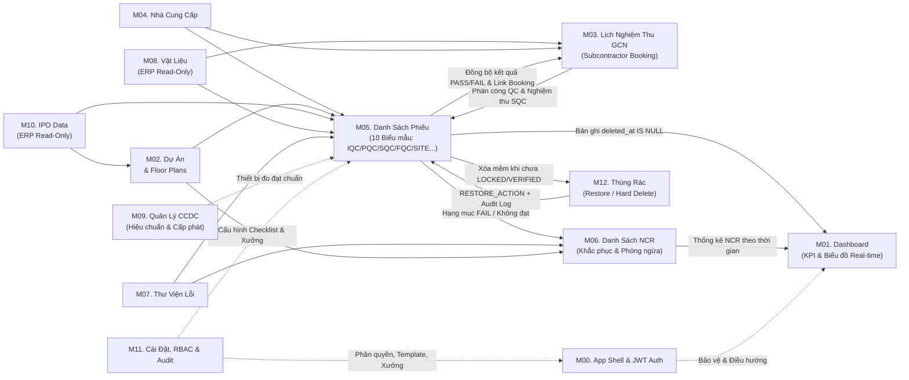

### Sơ đồ ASCII tóm tắt chuỗi giá trị nghiệp vụ

```text
[ERP Nguồn (Read-Only)]
  ├── M08 Material (PO / Vật tư) ──────────────────────┐
  └── M10 IPO Data (FO / Tender) ───┐                  │
                                    ▼                  ▼
[Danh Mục Chuẩn]               [M02 Dự Án]      [M03 Booking GCN] ──(QCAssignmentModal)──┐
  ├── M04 Nhà Cung Cấp ─────────►  │                  │                                  │
  ├── M07 Thư Viện Lỗi ────────────┼──► [M05 10 Biểu Mẫu Kiểm Tra] ◄─────────────────────┘
  └── M09 CCDC Đo Lường ───────────┘       │          │          │
                                           │(FAIL)    │(LOCKED)  │(Soft Delete)
                                           ▼          ▼          ▼
                                     [M06 NCR]   [M01 Dashboard] [M12 Thùng Rác]
                                                      ▲                │
                                                      └────(Restore)───┘
```

---

## Phần D — Đặc Tả Chi Tiết 13 Module (M00 – M12)

---

### M00. App Shell, Xác Thực & Điều Hướng Toàn Cục

#### 1. Mục tiêu & Phạm vi nghiệp vụ
Là lớp khung xương vận hành toàn bộ ứng dụng QMS: quản lý phiên đăng nhập bảo mật bằng JWT, nạp hồ sơ người dùng trực tiếp từ DB, điều phối điều hướng 12 module trên Desktop (Sidebar thu gọn/mở rộng) và Mobile (`MobileBottomBar` + `HomeMenu`), xử lý trung tâm thông báo và đường dẫn chia sẻ công khai QR Code.

#### 2. Chức năng chính (Nghiệp vụ & Giao diện)
- **Đăng nhập & Phục hồi mật khẩu (`LoginPage`):** Đăng nhập qua `username`/`password` nhận JWT; hỗ trợ luồng quên mật khẩu và đặt lại mật khẩu bằng mã xác thực hợp lệ (không trả `devCode` ra client).
- **Quản lý phiên & Tự động đăng xuất (`qms-auth-expired`):** Mọi response `401` hoặc khi khởi động không có token hợp lệ đều phát sự kiện `qms-auth-expired` để xóa token cục bộ và đưa về màn hình đăng nhập.
- **Header & Thanh điều hướng (`GlobalHeader`, `Sidebar`, `MobileBottomBar`, `HomeMenu`):** Hiển thị Logo AA Corporation, tên hệ thống, nút quét mã QR (`QRScannerModal`), chuông thông báo (`NotificationCenter` với đánh dấu đã đọc cá nhân/tất cả), đổi mật khẩu an toàn (`ChangePasswordModal` khóa IDOR chỉ đổi mật khẩu cho chính `req.authUser`), và nút Đăng xuất.
- **QR Public View (`/api/public/inspections/:id`):** Cho phép quét mã QR trên tem/phiếu in giấy để xem thông tin công khai của phiếu kiểm tra mà không cần đăng nhập tài khoản QMS.
- **Error Boundary:** Bắt lỗi render UI và cung cấp nút tải lại/thử lại an toàn.

#### 3. Workflow & State Machine

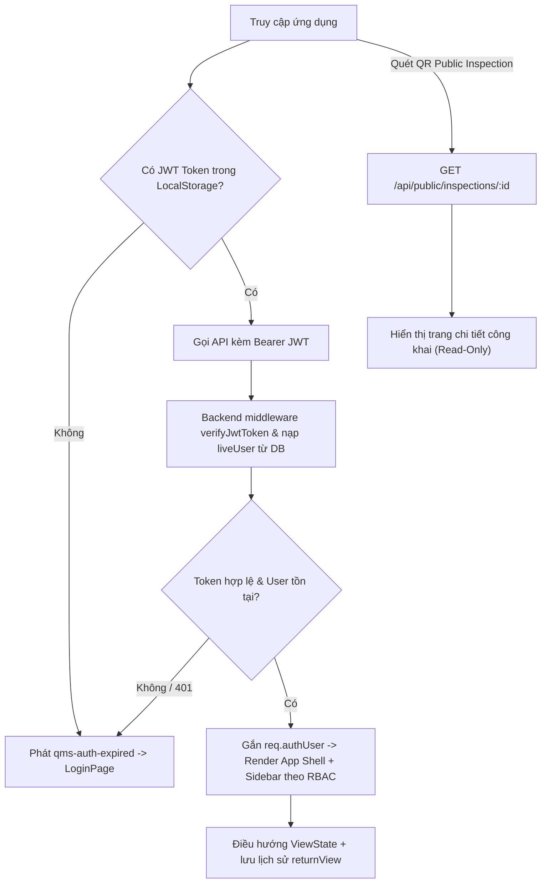

#### 4. Ma trận RBAC cấp Module & Quy tắc bảo vệ Backend
- **Quyền truy cập:** Mọi người dùng đã xác thực đều truy cập được App Shell cá nhân; danh sách item trong `Sidebar` được lọc động qua `hasPermission(user, rolesList, item.id, 'VIEW')` (riêng `ADMIN` thấy toàn bộ 12 mục).
- **Bảo vệ Backend:**
  - Middleware tại `server.ts` bắt buộc xác thực JWT cho mọi route `/api/*` trừ danh sách `isPublicApiRoute`.
  - Khóa IDOR trên `POST /api/auth/change-password`: lấy `userId` từ `req.authUser.id` (không tin `userId` từ body của user thường).
  - Khóa IDOR trên `/api/notifications`: user chỉ đọc/đánh dấu đã đọc thông báo thuộc về chính `req.authUser.id` (trừ `ADMIN`).

#### 5. Điểm tích hợp dữ liệu
- **API Endpoints:**
  - `GET /api/health`
  - `POST /api/auth/login`
  - `POST /api/auth/change-password`
  - `POST /api/auth/forgot-password`
  - `POST /api/auth/reset-password`
  - `GET /api/public/inspections/:id`
  - `GET /api/notifications`, `POST /api/notifications`, `POST /api/notifications/:id/read`, `POST /api/notifications/read-all`
  - `POST /api/storage/signed-upload-url`, `GET /api/storage/signed-download-url`, `PUT/POST /api/storage/upload`, `GET /api/storage/files/*storageKey`, `POST /api/upload`
  - `GET /api/proxy-image`, `GET /api/images/proxy`, `GET /api/media/image*`
- **Bảng PostgreSQL (`appQAQC`):** `users`, `notifications`, `qms_roles`.
- **Liên kết Module:** Bao bọc và cấp ngữ cảnh người dùng cho `M01`–`M12`.

---

### M01. Báo Cáo Tổng Hợp (Dashboard)

#### 1. Mục tiêu & Phạm vi nghiệp vụ
Cung cấp bức tranh điều hành chất lượng theo thời gian thực cho Ban Giám đốc, Quản lý QA/QC và Kiểm tra viên: theo dõi tổng số phiếu kiểm tra, tỷ lệ Đạt/Không đạt/Đang chờ, phân bổ theo xưởng/dự án/loại phiếu và xu hướng phát sinh sự cố NCR.

#### 2. Chức năng chính (Nghiệp vụ & Giao diện)
- **Thẻ KPI tổng quan:** Tổng phiếu kiểm tra, số lượng Đạt / Không đạt / Chờ duyệt / Nháp, tỷ lệ chất lượng (% Pass).
- **Bộ lọc đa chiều (`Filter Drawer / Bar`):** Lọc đồng thời theo Khoảng thời gian (`DateRangePicker`), Nhân sự QC, Xưởng sản xuất (`VẬT TƯ`, `GCN`, `LẮP ĐẶT` và các xưởng cấu hình), Loại phiếu (`IQC`, `PQC`, `SQC_VT`, `SQC_BTP`, `SQC_TP`, `FQC`, `SITE`, `SPR`, `STEP`, `FSR`), Dự án (`ma_ct`), Công đoạn (`inspectionStage`), và Trạng thái phiếu.
- **Biểu đồ phân tích (`Recharts`):** Biểu đồ tròn (PieChart) phân bổ trạng thái kết quả kiểm tra; Biểu đồ cột/đường theo dõi số lượng **NCR theo thời gian** hỗ trợ gom nhóm linh hoạt theo **Ngày (`DAY`) / Tuần (`WEEK`) / Tháng (`MONTH`) / Năm (`YEAR`)**.
- **Tương tác Drill-down:** Click vào cột ngày trên biểu đồ NCR để lọc danh sách các phiếu có NCR trong mốc thời gian đó và bấm điều hướng trực tiếp sang chi tiết phiếu kiểm tra (`onViewInspection`).

#### 3. Workflow & State Machine

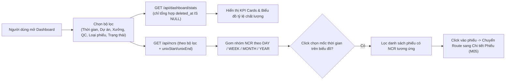

#### 4. Ma trận RBAC cấp Module & Quy tắc bảo vệ Backend
- **Quyền xem (`DASHBOARD:VIEW`):** Cho phép `ADMIN`, `MANAGER`, `QA`, `QC_LEAD`, `QC_INSPECTOR`, `PURCHASING` (tùy cấu hình `allowedModules` / `qms_roles`).
- **Quy tắc dữ liệu ISO:** Toàn bộ câu truy vấn thống kê ở Backend chỉ đếm trên các bản ghi có `deleted_at IS NULL` để không làm sai lệch chỉ số khi có phiếu bị xóa mềm đưa vào Thùng rác (M12).

#### 5. Điểm tích hợp dữ liệu
- **API Endpoints:** `GET /api/dashboard/stats`, `GET /api/inspections/projects`, `GET /api/ncrs`.
- **Bảng PostgreSQL (`appQAQC`):** `inspections`, `ncrs`, `projects`, `workshops`, `users`.
- **Liên kết Module:** Điều hướng trực tiếp tới phiếu kiểm tra thuộc `M05` và phản ánh dữ liệu tổng hợp từ `M02`, `M05`, `M06`, `M12`.

---

### M02. Quản Lý Dự Án (Projects & Floor Plan Layout)

#### 1. Mục tiêu & Phạm vi nghiệp vụ
Quản lý tập trung danh mục công trình/dự án (`ma_ct` duy nhất làm khóa truy xuất nguồn gốc ISO), phân loại theo khối kinh doanh, lưu trữ hồ sơ tài liệu dự án và định vị lỗi/kiểm tra trực quan trên mặt bằng bản vẽ (`Floor Plan & Layout Pins`).

#### 2. Chức năng chính (Nghiệp vụ & Giao diện)
- **Danh sách Dự án (`ProjectList`):** Chế độ xem Lưới (`GRID`) hoặc Danh sách (`LIST`), tìm kiếm nhanh theo mã/tên dự án, tự động phân nhóm theo tiền tố mã: **OEM (`EM*`)**, **Công trình nội địa (`CT*`)**, **NHÀ XINH (`AKA*` / tên chứa Nhà Xinh)** và **Nội bộ**.
- **Bộ lọc & Thống kê trên từng dự án:** Lọc theo Trạng thái dự án, PM, PC, QA phụ trách; hiển thị biểu đồ tiến độ đóng/mở các phiếu kiểm tra liên kết với dự án đó.
- **Chi tiết Dự án (`ProjectDetail`):** Cập nhật thông tin tiến độ, mô tả, nhân sự PM/PC/QA, và xem danh sách phiếu kiểm tra / NCR thuộc dự án.
- **Tài liệu dự án (`project_documents`):** Tải lên/xóa tài liệu kỹ thuật, hợp đồng, shopdrawing đính kèm dự án.
- **Quản lý Mặt bằng & Chốt vị trí (`FloorPlanLibrary`, `FloorPlanUploadModal`, `LayoutManager`):** Tải lên sơ đồ mặt bằng (`floor_plans`) theo dự án/tầng và gắn ghim tọa độ `(coord_x, coord_y)` (`layout_pins`) liên kết trực tiếp với phiếu kiểm tra hiện trường (`SITE` / `FSR` / `FQC`).

#### 3. Workflow & State Machine

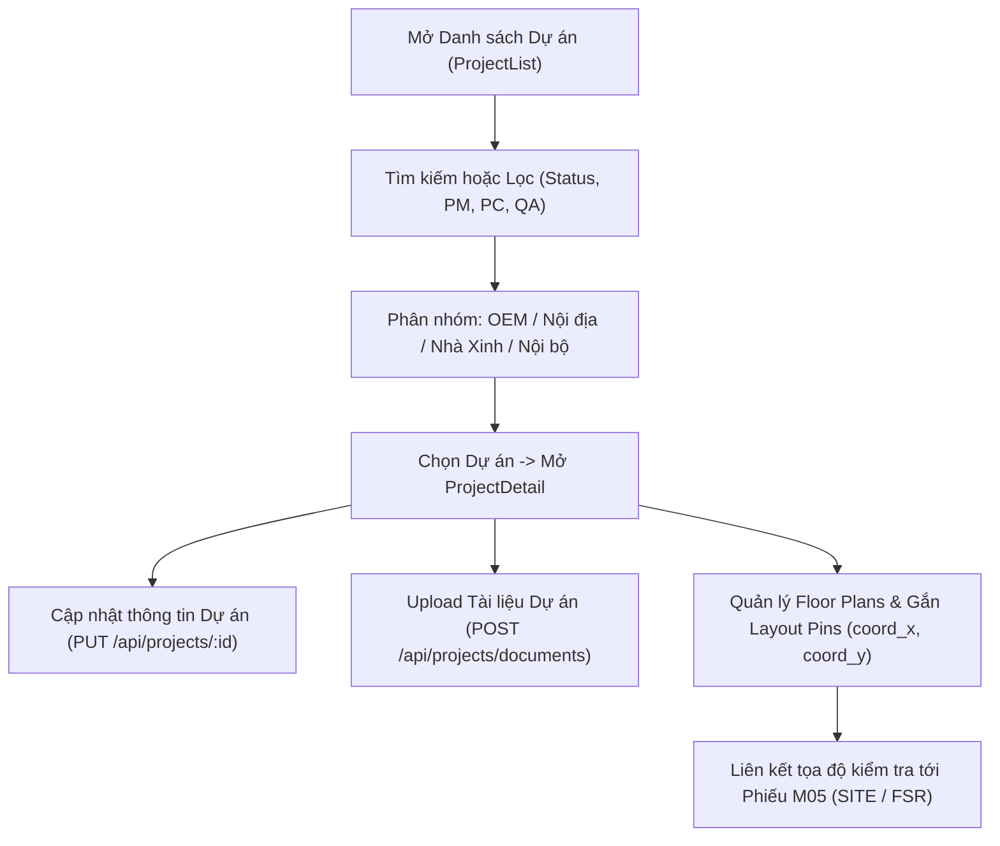

#### 4. Ma trận RBAC cấp Module & Quy tắc bảo vệ Backend
- **Xem (`PROJECTS:VIEW`):** `ADMIN`, `MANAGER`, `QA`, `QC_LEAD`, `QC_INSPECTOR`, `PURCHASING`.
- **Chỉnh sửa dự án / Upload tài liệu / Mặt bằng (`PROJECTS:CREATE` / `EDIT` / `DELETE`):** Phân quyền theo role và ma trận `qms_roles` (Admin, Manager, QA, QC Lead, hoặc QC thực địa được cấp quyền gắn Pin).
- **Quy tắc ISO:** Mã công trình `ma_ct` là định danh tham chiếu xuyên suốt trong `inspections`, `ncrs`, `ipo`, và `project_documents`.

#### 5. Điểm tích hợp dữ liệu
- **API Endpoints:**
  - `GET /api/projects`, `GET /api/projects/:code`, `PUT /api/projects/:id`
  - `GET /api/projects/:projectId/documents`, `POST /api/projects/documents`, `DELETE /api/projects/documents/:id`
  - `GET /api/floor-plans`, `POST /api/floor-plans`, `DELETE /api/floor-plans/:id`
  - `GET /api/layout-pins`, `POST /api/layout-pins`
  - `GET /api/plans`
- **Bảng PostgreSQL (`appQAQC`):** `projects`, `project_documents`, `floor_plans`, `layout_pins`, `inspections`.
- **Liên kết Module:** Cung cấp `ma_ct` / `ten_ct` và mặt bằng cho `M05` (đặc biệt form `SITE`, `FSR`) và thống kê `M01`, `M06`.

---

### M03. Lịch Nghiệm Thu GCN (Subcontractor Booking & QC Assignment)

#### 1. Mục tiêu & Phạm vi nghiệp vụ
Điều phối toàn bộ quy trình đặt lịch kiểm tra gia công ngoài (SQC) giữa Thu mua / Nhà cung cấp phụ và bộ phận QA/QC: kiểm soát hạn chót đặt lịch, phân công hoặc trả lại hồ sơ bổ sung thông qua `QCAssignmentModal`, chuyển thẳng sang lập biên bản nghiệm thu SQC (`SQC_VT`, `SQC_BTP`, `SQC_TP`), đối chiếu kết quả và theo dõi tái kiểm định.

#### 2. Chức năng chính (Nghiệp vụ & Giao diện)
- **Bảng danh sách Booking chuẩn 7 cột (`SubcontractorBookingManagement`):** Hiển thị gọn gàng Mã Booking / Loại SQC, Số PO & NCC, Hạng mục/Số lượng, Ngày nghiệm thu + **Ngày đề xuất dời lịch** (`suggestedDate` hiển thị bên dưới), Chuyên viên QC phụ trách, Trạng thái, và Cột Thao tác động.
- **Quy tắc đặt lịch 15:00 (`getBookingDatePolicy`):** Nếu đặt lịch trước 15:00 ngày T, ngày nghiệm thu sớm nhất là T+1; nếu sau 15:00 ngày T, ngày nghiệm thu sớm nhất là T+2.
- **Tra cứu vật tư theo PO (`lookupPoMaterials`):** Khi tạo/sửa booking, tự động gợi ý danh sách vật tư, số lượng và quy cách từ dữ liệu PO/ERP.
- **Nút tác nghiệp động theo trạng thái:**
  - `PENDING` (Chờ phân công): Hiển thị nút **Phân công** → mở `QCAssignmentModal`.
  - `ASSIGNED` (Chờ nghiệm thu): Hiển thị nút **Nghiệm thu** → mở form lập phiếu SQC tương ứng (`SQC_VT` / `SQC_BTP` / `SQC_TP`) mang sẵn thông tin booking.
  - `RETURNED_FOR_SUPPLEMENT` (Trả lại bổ sung / Nghiệm thu lại): Hiển thị nút **Nghiệm thu lại** hoặc **Phân công lại** cùng lý do trả lại (`rejectionReason`) & ngày đề xuất (`suggestedDate`).
  - `COMPLETED` (Hoàn tất): Hiển thị nút **Chi tiết** (`BookingDetailModal`) kèm danh sách phiếu SQC liên quan (`related-sqc`).
- **`QCAssignmentModal` (Phân công & Phản hồi đa chế độ):**
  - Chọn nhân sự QC qua `<Combobox>` (ưu tiên hiển thị nhân sự thuộc khối/vai trò QC lên đầu danh sách nhưng vẫn cho phép tìm kiếm toàn bộ nhân sự).
  - Nhập **Ghi chú phản hồi (`rejectionReason` / `notes`)** và **Đề xuất ngày nghiệm thu (`suggestedDate`)**.
  - Hỗ trợ **2 chế độ lưu:** (1) *Xác nhận phân công QC* (`ASSIGNED`), hoặc (2) *Trả lại yêu cầu bổ sung* (`RETURNED_FOR_SUPPLEMENT`) — lưu an toàn các trường phản hồi vào cột `data` JSONB của `subcontractor_bookings`, tự động ghi Audit Trail và bắn thông báo chuông tới đúng `assigned_qc_id` / người tạo.
- **Đối chiếu tự động & Chi phí tái kiểm (`Reconcile` & `subcontractor_reinspection_costs`):** Nút **Đối chiếu SQC** rà soát liên kết theo `PO` / `PR` / `BOOKING` / `MATERIAL`, tự động đóng (`COMPLETED`) hoặc ghi nhận nghiệm thu lại nếu phiếu SQC trả về `FAIL` / `REJECTED`.

#### 3. Workflow & State Machine

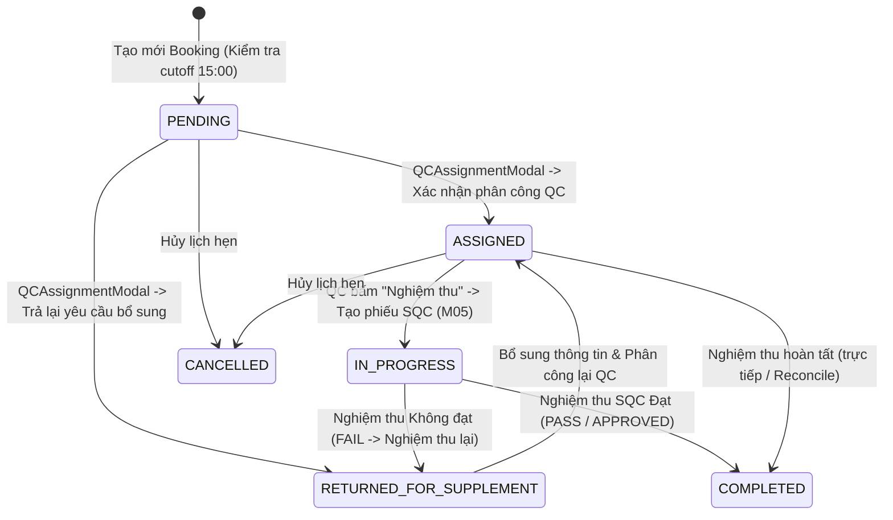

> **Quy tắc Zero Modal Nesting tại M03:** Khi mở `QCAssignmentModal` từ `BookingDetailModal`, hoặc khi bấm vào phiếu SQC liên quan bên trong `BookingDetailModal`, hệ thống đóng `BookingDetailModal` trước khi chuyển sang modal phân công hoặc điều hướng tới Route chi tiết phiếu M05.

#### 4. Ma trận RBAC cấp Module & Quy tắc bảo vệ Backend
- **Tạo/Sửa lịch booking:** `ADMIN`, `MANAGER`, `PURCHASING`, `VENDOR` (lịch thuộc xưởng/tài khoản của mình), `QC_LEAD`.
- **Phân công QC & Trả lại yêu cầu bổ sung:** `ADMIN`, `MANAGER`, `QA`, `QC_LEAD`.
- **Thực hiện nghiệm thu SQC:** `QC_INSPECTOR` được gán (`assigned_qc_id`), `QC_LEAD`, `MANAGER`, `ADMIN`.
- **Bảo vệ Backend:**
  - Cập nhật qua `PATCH/PUT /api/subcontractor-bookings/:id` với cột `data` JSONB (`rejectionReason`, `suggestedDate`, `rejectedAt`, `rejectedByName`) và `assigned_qc_id` / `assigned_qc_name`.
  - Hỗ trợ Soft Delete qua cột `deleted_at` trên `subcontractor_bookings`.
  - Tự động kích hoạt thông báo chuông (`notifications`) chính xác cho `assigned_qc_id`.

#### 5. Điểm tích hợp dữ liệu
- **API Endpoints:**
  - `GET /api/subcontractor-bookings`, `GET /api/subcontractor-bookings/:id`, `POST /api/subcontractor-bookings`, `PATCH /api/subcontractor-bookings/:id`, `PUT /api/subcontractor-bookings/:id`, `DELETE /api/subcontractor-bookings/:id`
  - `POST /api/subcontractor-bookings/reconcile`
  - `GET /api/subcontractor-bookings/:id/related-sqc`
  - `GET /api/po-materials/lookup`
  - `GET /api/subcontractor-inspections`, `GET /api/subcontractor-reinspection-costs`
- **Bảng PostgreSQL (`appQAQC`):** `subcontractor_bookings`, `subcontractor_inspections`, `subcontractor_reinspection_costs`, `inspections`, `forms_sqc_vt`, `forms_sqc_btp`, `forms_sqc_tp`, `notifications`, `audit_logs`.
- **Liên kết Module:** Lấy vật tư từ `M08`, lấy/đồng bộ nhà cung cấp sang `M04`, sinh phiếu kiểm tra sang `M05` và nhận trạng thái đối chiếu ngược từ `M05`.

---

### M04. Nhà Cung Cấp (Supplier Management)

#### 1. Mục tiêu & Phạm vi nghiệp vụ
Quản lý tập trung hồ sơ nhà cung cấp vật tư và xưởng gia công ngoài (Vendor/Subcontractor), cung cấp thống kê năng lực chất lượng (tổng số phiếu kiểm tra, tỷ lệ đạt, lịch sử vật tư cung cấp) phục vụ đánh giá Vendor định kỳ.

#### 2. Chức năng chính (Nghiệp vụ & Giao diện)
- **Danh sách & Tìm kiếm (`SupplierManagement`):** Hiển thị danh sách NCC (phân trang), sắp xếp theo số lượng báo cáo (`reports`), tìm kiếm theo mã/tên/người liên hệ; hỗ trợ Import/Export Excel & CSV.
- **Đồng bộ tự động từ Booking (`sync-from-bookings`):** Cho phép quét tên nhà cung cấp từ các lịch nghiệm thu GCN (M03) để khởi tạo nhanh hồ sơ NCC chưa có trong danh mục.
- **Chi tiết Nhà cung cấp (`SupplierDetail`):** Xem thông tin liên hệ (người đại diện, SĐT, Email, địa chỉ xưởng), thống kê chỉ số chất lượng (`/api/suppliers/stats`), danh sách toàn bộ phiếu kiểm tra IQC/SQC (`/api/suppliers/inspections`) và danh mục vật tư đã giao (`/api/suppliers/materials`).

#### 3. Workflow & State Machine

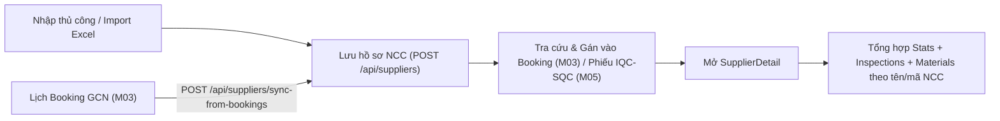

#### 4. Ma trận RBAC cấp Module & Quy tắc bảo vệ Backend
- **Xem (`SUPPLIERS:VIEW`):** `ADMIN`, `MANAGER`, `QA`, `QC_LEAD`, `QC_INSPECTOR`, `PURCHASING`.
- **Tạo / Sửa / Import / Sync (`SUPPLIERS:CREATE` / `EDIT` / `IMPORT`):** `ADMIN`, `MANAGER`, `QA`, `PURCHASING`.
- **Xóa (`SUPPLIERS:DELETE`):** `ADMIN`, `MANAGER` (dùng Soft Delete với cột `deleted_at`).

#### 5. Điểm tích hợp dữ liệu
- **API Endpoints:**
  - `GET /api/suppliers`, `GET /api/suppliers/find-by-name`, `POST /api/suppliers`, `DELETE /api/suppliers/:id`
  - `POST /api/suppliers/sync-from-bookings`
  - `GET /api/suppliers/stats`, `GET /api/suppliers/inspections`, `GET /api/suppliers/materials`
- **Bảng PostgreSQL (`appQAQC`):** `suppliers`, `subcontractor_bookings`, `inspections`, `material`.
- **Liên kết Module:** Cung cấp dữ liệu địa chỉ và liên hệ NCC cho `M03` (Booking) và `M05` (phiếu `IQC`, `SQC_*`).

---

### M05. Danh Sách Phiếu Kiểm Tra (Inspections / 10 Biểu Mẫu QMS)

#### 1. Mục tiêu & Phạm vi nghiệp vụ
Là phân hệ nghiệp vụ trung tâm của QMS, quản lý toàn bộ 10 loại biên bản kiểm tra chất lượng từ đầu vào (IQC), gia công ngoài (SQC), sản xuất tại xưởng (PQC, STEP), hoàn thiện đóng gói (FQC), lắp đặt hiện trường (SITE, FSR, SPR): duyệt theo 4 cột tuần tự, ký duyệt 2 cấp chuẩn ISO, gắn Audit Trail vĩnh viễn và xuất/chia sẻ báo cáo.

#### 2. Chức năng chính (Nghiệp vụ & Giao diện)
- **Điều hướng 4 cột tuần tự (`InspectionList`):**
  1. **Cột 1 — Thời gian:** Danh sách các ngày có phiếu theo GMT+7 (`/api/inspections/dates`) + nút **"Tất cả"** chủ động.
  2. **Cột 2 — Dự án:** Các dự án phát sinh phiếu trong ngày đã chọn (`/api/inspections/projects`).
  3. **Cột 3 — Danh sách Phiếu / Hạng mục:** Thẻ phiếu kèm cảnh báo SLA quá hạn duyệt (Cảnh báo vàng > 12h ở trạng thái chờ duyệt; Cảnh báo đỏ > 24h), liên kết `LinkedBookingsBadgeBar`.
  4. **Cột 4 — Chi tiết Phiếu (`inspectiondetail*`):** Xem đầy đủ thông tin, vật tư, bảng checklist, hình ảnh hiện trường, chữ ký số 2 cấp (`TwoTierApproval`) và nút hành động theo trạng thái.
- **10 Biểu mẫu Form nhập & 10 Màn hình Chi tiết chuyên biệt:**
  - `IQC` (Kiểm tra vật tư đầu vào — hỗ trợ bảng nhiều vật tư `materials` + hồ sơ CO/CQ `supportingDocs`)
  - `PQC` (Kiểm tra công đoạn sản xuất tại xưởng)
  - `SQC_VT` (Gia công ngoài — Vật tư), `SQC_BTP` (Gia công ngoài — Bán thành phẩm), `SQC_TP` (Gia công ngoài — Thành phẩm) *(hỗ trợ ánh xạ tương thích ngược `SQC_MAT` / `forms_sqc_mat`)*
  - `FQC` (Kiểm tra thành phẩm trước xuất xưởng)
  - `FSR` (Kiểm tra nghiệm thu / Field Service Report)
  - `SITE` (Kiểm tra lắp đặt công trình — gắn tọa độ `floor_plan_id`, `coord_x`, `coord_y`)
  - `STEP` (Kiểm tra theo công đoạn chi tiết — `inspectionformStepVecni` / `inspectiondetailStepVecni`)
  - `SPR` (Báo cáo kiểm tra chuyên biệt / Special Report)
- **Cơ chế Hydration, Đồng bộ & Ảnh hiện trường:**
  - Tự động đồng bộ các bản ghi còn thiếu giữa các bảng `forms_*` và bảng tổng hợp `inspections` qua `POST /api/inspections/sync`.
  - Hỗ trợ `ImageEditorModal` (vẽ chú thích lỗi trực tiếp lên ảnh), xem ảnh qua proxy CDN đa tầng Google Drive và Google Workspace OAuth (`drive.readonly`).
- **Ký duyệt 2 cấp (`TwoTierApproval`) & Audit Trail:** Lưu chữ ký số (`SignaturePad`), ghi nhận người duyệt Cấp 1 (`SIGN1` — Tổ trưởng QC / Trưởng bộ phận) và Cấp 2 (`SIGN2` — QA/Manager), kèm lịch sử biến động vĩnh viễn (`/api/inspections/:id/audit-logs`).

#### 3. Workflow & State Machine (Server-Authoritative)

Backend (`services/dbModuleService.ts`) ép buộc nghiêm ngặt máy trạng thái ISO. Dữ liệu cũ (như `PENDING`, `FLAGGED`, `COMPLETED`) được chuẩn hóa ánh xạ trước khi kiểm tra chuyển trạng thái; mọi chuyển bước nhảy cóc hoặc sửa phiếu `LOCKED` đều bị từ chối:

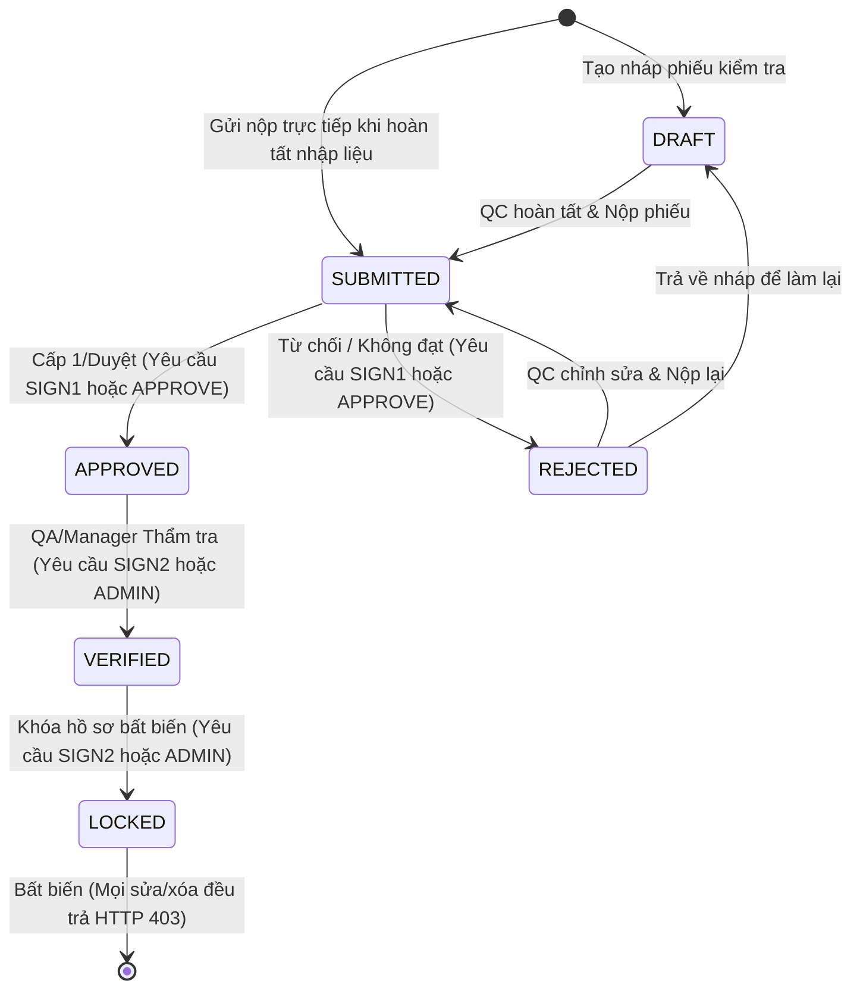

> **Kiểm soát xung đột (Optimistic Locking):** Khi lưu/duyệt, Backend so sánh `version` của payload với DB; nếu khác nhau trả về HTTP `409 Conflict`.

#### 4. Ma trận RBAC cấp Module & Quy tắc bảo vệ Backend
- **Tạo/Sửa phiếu (`DRAFT` / `SUBMITTED` / `REJECTED`):** `ADMIN`, `MANAGER`, `QA`, `QC_LEAD`, `QC_INSPECTOR` (hoặc người tạo `inspectorName === user.name` qua `canUserModifyInspection`). Khi phiếu đã `APPROVED`, `VERIFIED`, `COMPLETED`, hoặc `LOCKED`, Frontend và Backend đều khóa sửa đổi nội dung nghiệp vụ.
- **Duyệt Cấp 1 (`SUBMITTED` → `APPROVED`/`REJECTED`):** Yêu cầu `SIGN1` hoặc `APPROVE` (`la_to_truong`, `QC_LEAD`, `MANAGER`, `ADMIN`).
- **Thẩm tra & Khóa Cấp 2 (`APPROVED` → `VERIFIED` → `LOCKED`):** Yêu cầu `SIGN2` hoặc `ADMIN` (`MANAGER`, `QA`, `ADMIN`).
- **Xóa mềm (`DELETE /api/inspections/:id`):** Yêu cầu `INSPECTIONS:DELETE` hoặc `ADMIN`. **Chặn tuyệt đối (`403`)** nếu phiếu đang ở trạng thái `LOCKED`, `VERIFIED`, hoặc `COMPLETED`.

#### 5. Điểm tích hợp dữ liệu
- **API Endpoints:**
  - `GET /api/inspections`, `GET /api/inspections/dates`, `GET /api/inspections/projects`, `GET /api/inspections/:id`
  - `POST /api/inspections`, `POST /api/inspections/sync`, `DELETE /api/inspections/:id`
  - `GET /api/inspections/:id/related-bookings`, `GET /api/inspections/:id/audit-logs`
  - `GET /api/public/inspections/:id` (QR công khai)
- **Bảng PostgreSQL (`appQAQC`):** `inspections`, 11 bảng `forms_*` (`forms_iqc`, `forms_pqc`, `forms_sqc_vt`, `forms_sqc_btp`, `forms_sqc_tp`, `forms_sqc_mat`, `forms_fqc`, `forms_fsr`, `forms_step`, `forms_spr`, `forms_site`), `audit_logs`, `status_history`.
- **Liên kết Module:** Nhận ngữ cảnh từ `M02`, `M03`, `M04`, `M07`, `M08`, `M10`; đồng bộ trạng thái về `M03`; phát sinh `M06` (NCR); cung cấp số liệu cho `M01` và chuyển bản ghi xóa mềm sang `M12`.

---

### M06. Danh Sách NCR (Non-Conformance Report)

#### 1. Mục tiêu & Phạm vi nghiệp vụ
Quản lý toàn bộ Báo cáo Sự không phù hợp (NCR) phát sinh từ quá trình kiểm tra chất lượng: ghi nhận lỗi thực tế, truy xuất nguyên nhân gốc rễ (Root Cause), giao người phụ trách khắc phục, theo dõi hành động khắc phục (Corrective Action) & phòng ngừa (Preventive Action), thẩm tra hiệu quả trước khi đóng hồ sơ ISO.

#### 2. Chức năng chính (Nghiệp vụ & Giao diện)
- **Danh sách NCR (`NCRList`):** Hỗ trợ tìm kiếm, lọc theo Thời gian (`DateRangePicker`), Dự án, Xưởng, Người kiểm tra, Mức độ (`severity`), Trạng thái; hỗ trợ Import/Export danh sách NCR.
- **Hiển thị dữ liệu liên kết (`LEFT JOIN inspections`):** Mỗi NCR tự động kế thừa và hiển thị đầy đủ thông tin dự án (`ma_ct`, `ten_ct`), hạng mục (`ten_hang_muc`), xưởng và QC lập phiếu từ `inspection_id`.
- **Chi tiết & Xử lý NCR (`NCRDetail`):**
  - Xem thông tin lỗi, ảnh hiện trường, nguyên nhân gốc rễ, giải pháp khắc phục/phòng ngừa, người chịu trách nhiệm (`responsiblePerson`), hạn hoàn thành (`deadline`).
  - Điều hướng ngược sang phiếu kiểm tra gốc (`onSelectNcr(inspectionId)`) hoặc mở phiếu liên quan.
  - Cập nhật & lưu thông qua `saveNcrMapped` (kèm `version` Optimistic Locking).

#### 3. Workflow & State Machine (Server-Authoritative)

Backend (`services/dbService.ts`) ép buộc luồng trạng thái chuẩn ISO (ánh xạ tương thích ngược `PENDING` → `OPEN`, `IN_PROGRESS` → `CORRECTED`):

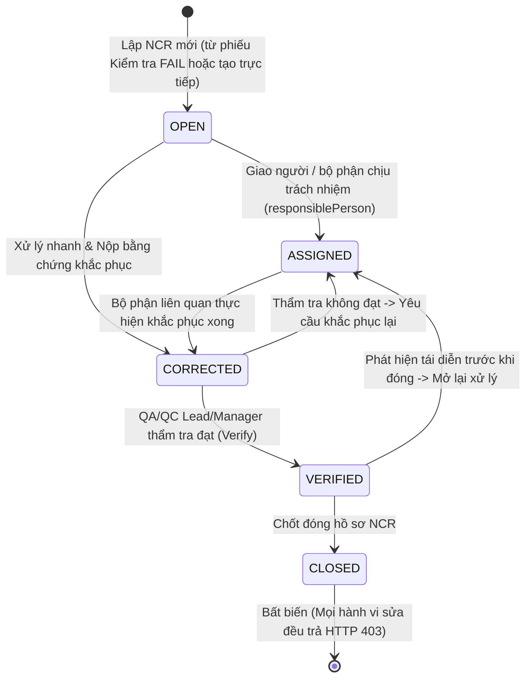

#### 4. Ma trận RBAC cấp Module & Quy tắc bảo vệ Backend
- **Tạo & Cập nhật khắc phục (`OPEN` → `ASSIGNED` → `CORRECTED`):** `ADMIN`, `MANAGER`, `QA`, `QC_LEAD`, `QC_INSPECTOR` (và nhân sự/nhà cung cấp được gán xử lý nếu có quyền `EDIT`).
- **Thẩm tra & Đóng NCR (`VERIFIED`, `CLOSED`):** Backend giới hạn nghiêm ngặt chỉ cho phép `ADMIN`, `MANAGER`, `QC_LEAD`, `QA`, hoặc user có cờ `la_to_truong` thực hiện chuyển sang `VERIFIED` hoặc `CLOSED`.
- **Tính bất biến & Xóa mềm:** Khi NCR đã đạt `CLOSED`, mọi request cập nhật tiếp theo bị chặn HTTP `403`. Xóa NCR sử dụng Soft Delete (`deleted_at`).

#### 5. Điểm tích hợp dữ liệu
- **API Endpoints:** `GET /api/ncrs`, `GET /api/ncrs/:id`, `POST /api/ncrs`, `DELETE /api/ncrs/:id`, `GET /api/defects`.
- **Bảng PostgreSQL (`appQAQC`):** `ncrs`, `inspections`, `defect_library`, `audit_logs`.
- **Liên kết Module:** Khởi tạo từ kết quả `FAIL` của `M05`, tham chiếu mã lỗi chuẩn từ `M07`, đối chiếu dự án `M02`, và đẩy số liệu xu hướng lên biểu đồ `M01`.

---

### M07. Thư Viện Lỗi (Defect Library)

#### 1. Mục tiêu & Phạm vi nghiệp vụ
Xây dựng **Nguồn chân lý duy nhất (Single Source of Truth)** về danh mục lỗi tiêu chuẩn theo từng công đoạn sản xuất/kiểm tra, giúp Kiểm tra viên chọn nhanh mã lỗi, phân biệt đúng-sai trực quan bằng hình ảnh mẫu và thống nhất hướng xử lý.

#### 2. Chức năng chính (Nghiệp vụ & Giao diện)
- **Hiển thị phân nhóm Accordion theo Công đoạn (`stage`):** Tự động lấy danh sách công đoạn từ cấu hình xưởng (`workshops`) hoặc mặc định (`Chung`, `IQC`, `PQC`, `FQC`, `Site`), hiển thị số lượng lỗi chuẩn trong từng nhóm.
- **Phân loại & Mức độ nghiêm trọng:** Phân loại kỹ thuật (`Ngoại quan`, `Kết cấu`, `Kích thước`, `Phụ kiện`) và mức độ (`MINOR`, `MAJOR`, `CRITICAL`).
- **Trực quan Đúng / Sai (`correctImage` / `incorrectImage`):** Cho phép tải lên ảnh chuẩn (Đạt) và ảnh lỗi (Không đạt) kèm Nguyên nhân gốc rễ (`rootCause`) và Biện pháp khắc phục gợi ý (`suggestedAction`).
- **Tìm kiếm & Import/Export:** Tìm theo mã lỗi (`DEF_*`), tên lỗi, mô tả; hỗ trợ xuất CSV Stream, Excel `.xlsx` và nhập hàng loạt từ Excel `.xlsx`.

#### 3. Workflow & State Machine

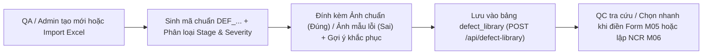

#### 4. Ma trận RBAC cấp Module & Quy tắc bảo vệ Backend
- **Xem (`DEFECT_LIBRARY:VIEW`):** Toàn bộ nhân sự nội bộ được cấp quyền xem (`ADMIN`, `MANAGER`, `QA`, `QC_LEAD`, `QC_INSPECTOR`, `PURCHASING`).
- **Tạo / Sửa / Xóa / Import (`CREATE`/`EDIT`/`DELETE`/`IMPORT`):** Chủ yếu giới hạn cho khối quản lý chất lượng (`ADMIN`, `MANAGER`, `QA` — biến `isQA` trong giao diện kết hợp kiểm tra quyền `hasPermission`).
- **Xuất dữ liệu (`EXPORT`):** Cho phép theo action `DEFECT_LIBRARY:EXPORT`.

#### 5. Điểm tích hợp dữ liệu
- **API Endpoints:** `GET /api/defect-library`, `POST /api/defect-library`, `DELETE /api/defect-library/:id`.
- **Bảng PostgreSQL (`appQAQC`):** `defect_library`, `workshops`.
- **Liên kết Module:** Cung cấp chuẩn lỗi tham chiếu cho checklist `M05` và mô tả chuẩn cho `M06`.

---

### M08. Quản Lý Vật Liệu (Material — Read-Only)

#### 1. Mục tiêu & Phạm vi nghiệp vụ
Cung cấp giao diện tra cứu và tham chiếu danh mục nguyên vật liệu, đơn mua hàng (PO) đồng bộ từ hệ thống ERP nguồn để phục vụ kiểm tra đầu vào `IQC`, kiểm tra gia công ngoài `SQC_VT` và đối chiếu chứng từ vật tư.

#### 2. Chức năng chính (Nghiệp vụ & Giao diện)
- **Tra cứu vật tư phân trang (`MaterialManagement`):** Hiển thị 50 dòng/trang theo mã vật liệu (`material`), mô tả ngắn (`shortText`), đơn vị đặt (`orderUnit`), số lượng (`orderQuantity`), nhà cung cấp (`supplierName`), chứng từ mua (`purchaseDocument`), mã Tender (`Ma_Tender`), lệnh sản xuất (`Factory_Order`), ngày giao (`deliveryDate`).
- **Tìm kiếm & Xuất báo cáo:** Tìm kiếm nhanh theo từ khóa và xuất danh sách ra CSV / Excel `.xlsx`.
- **Ràng buộc Read-Only tuyệt đối:** Ứng dụng QMS chỉ sử dụng `SELECT/JOIN` để tham chiếu, không được phép thêm/sửa/xóa trực tiếp vào bảng gốc `material`.

#### 3. Workflow & State Machine

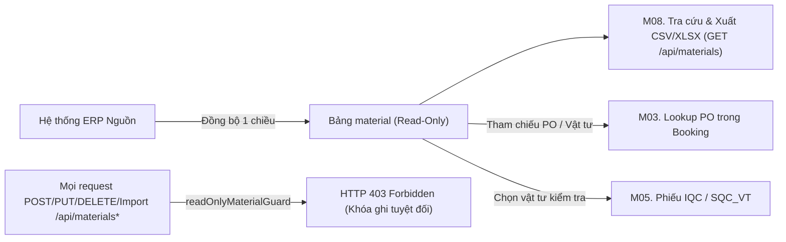

#### 4. Ma trận RBAC cấp Module & Quy tắc bảo vệ Backend
- **Quyền xem & xuất (`MATERIALS:VIEW`, `EXPORT`):** `ADMIN`, `MANAGER`, `QA`, `QC_LEAD`, `QC_INSPECTOR`, `PURCHASING`.
- **Bảo vệ Backend (`readOnlyMaterialGuard` tại `server.ts`):** Mọi lời gọi `POST /api/materials`, `PUT /api/materials/:id`, `DELETE /api/materials/:id`, `POST /api/import/materials` bị **chặn cứng ở Backend với HTTP `403`** nhằm bảo toàn nguyên vẹn dữ liệu ERP.

#### 5. Điểm tích hợp dữ liệu
- **API Endpoints:** `GET /api/materials`, `GET /api/po-materials/lookup` *(các route mutation trả HTTP `403`)*.
- **Bảng PostgreSQL:** `material` (Read-Only).
- **Liên kết Module:** Cung cấp dữ liệu PO/vật tư nền tảng cho `M03`, `M04` và `M05`.

---

### M09. Quản Lý CCDC (Tools & Calibration Assets)

#### 1. Mục tiêu & Phạm vi nghiệp vụ
Quản lý vòng đời Công cụ Dụng cụ đo lường (thước kẹp, máy đo ẩm, cân kỹ thuật, thiết bị kiểm tra...) của đội ngũ QA/QC: chuẩn hóa danh mục thiết bị, quản lý từng cá thể theo mã tài sản/serial, ghi nhận luân chuyển giữa Kho Tổng và nhân sự QC, và giám sát lịch sử hiệu chuẩn (Calibration) nhằm đảm bảo độ chính xác khi đo kiểm.

#### 2. Chức năng chính (Nghiệp vụ & Giao diện)
- **2 Tab thao tác chính (`ToolsManagement`):**
  - **Tab Thiết bị của tôi (`MY_TOOLS`):** Liệt kê các CCDC mà nhân sự đang trực tiếp quản lý/giữ, cho phép chọn nhiều thiết bị để luân chuyển hoặc trả về Kho Tổng.
  - **Tab Kho & Danh mục (`KHO`):** Quản lý Danh mục dòng thiết bị (`ToolCatalog`) và từng cá thể thiết bị vật lý (`ToolAsset`) thuộc danh mục đó.
- **Điều chuyển thiết bị (`ToolTransfer`):** Luân chuyển từ Kho Tổng (`KHO_TONG`) sang cá nhân QC (chọn qua `QCSelectionCombobox`) hoặc thu hồi về Kho Tổng kèm chữ ký số bàn giao (`SignaturePad`).
- **Lịch sử Hiệu chuẩn (`ToolCalibration`):** Lưu chứng chỉ/kết quả kiểm định định kỳ, ngày hiệu chuẩn gần nhất, ngày hết hạn hiệu chuẩn tiếp theo và ảnh chứng nhận đính kèm.

#### 3. Workflow & State Machine

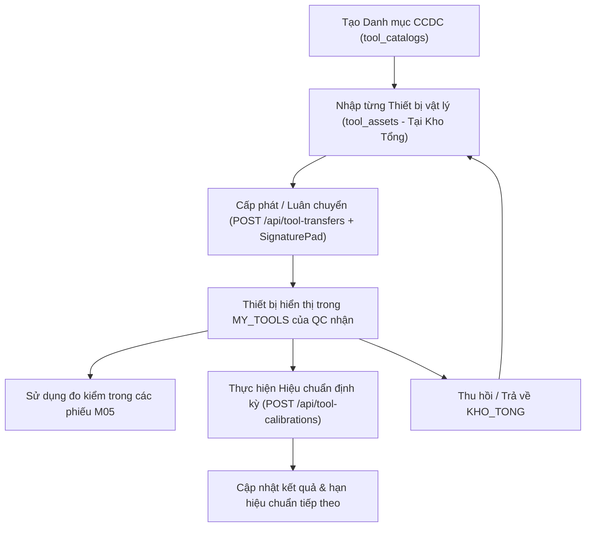

#### 4. Ma trận RBAC cấp Module & Quy tắc bảo vệ Backend
- **Quản lý Danh mục, Kho & Cấp phát (`TOOLS:CREATE`, `EDIT`, `SIGN2` hoặc `ADMIN`/`MANAGER`):** Tạo/sửa/xóa `tool_catalogs` và `tool_assets`, cấp phát cho toàn bộ nhân sự.
- **Nhân sự QC (`TOOLS:VIEW`):** Xem CCDC trong `MY_TOOLS`, ghi nhận bàn giao nhận thiết bị và cập nhật chứng từ hiệu chuẩn theo phân quyền.

#### 5. Điểm tích hợp dữ liệu
- **API Endpoints:**
  - `GET /api/tool-catalogs`, `POST /api/tool-catalogs`, `DELETE /api/tool-catalogs/:id`
  - `GET /api/tool-assets`, `GET /api/tool-catalogs/:catalogId/assets`, `POST /api/tool-assets`, `DELETE /api/tool-assets/:id`
  - `GET /api/tool-assets/:assetId/transfers`, `POST /api/tool-transfers`
  - `GET /api/tool-assets/:assetId/calibrations`, `POST /api/tool-calibrations`
- **Bảng PostgreSQL (`appQAQC`):** `tool_catalogs`, `tool_assets`, `tool_transfers`, `tool_calibrations`, `users`.
- **Liên kết Module:** Đồng bộ danh sách nhân sự từ `M11` (`users`) và đảm bảo năng lực thiết bị đo cho `M05`.

---

### M10. IPO Data (Đơn Hàng Sản Xuất ERP — Read-Only)

#### 1. Mục tiêu & Phạm vi nghiệp vụ
Tra cứu kế hoạch và đơn hàng sản xuất (Factory Order / Tender / IPO Quantity) đồng bộ từ hệ thống ERP để bộ phận QA/QC đối chiếu đúng quy cách kỹ thuật, số lượng đặt hàng và quản lý thông tin phụ trợ (bản vẽ, lịch sử mẫu, thông số vật tư bổ sung) mà không làm biến đổi bảng dữ liệu ERP gốc.

#### 2. Chức năng chính (Nghiệp vụ & Giao diện)
- **Danh sách IPO phân nhóm theo Dự án (`IPOPage`):** Tìm kiếm theo Mã FO (`ID_Factory_Order`), Mã Tender (`Ma_Tender`), Tên vật tư/hạng mục (`Material_description`); phân trang 50 dòng/trang; xuất CSV / Excel `.xlsx`.
- **Chi tiết IPO (`IPODetail`) & Các bảng phụ trợ ghi được:**
  - Xem thông số gốc từ bảng `ipo` (Read-Only).
  - Quản lý thông tin mở rộng tại các bảng phụ trợ QMS: chi tiết bổ sung (`ipo_details`), danh sách bản vẽ (`ipo_drawing_list`), lịch sử vật tư phụ (`ipo_material_history`), và lịch sử mẫu thử (`ipo_sample_history`).
- **Ràng buộc Read-Only tuyệt đối:** Bảng `ipo` gốc bị khóa hoàn toàn mọi lệnh ghi từ QMS.

#### 3. Workflow & State Machine

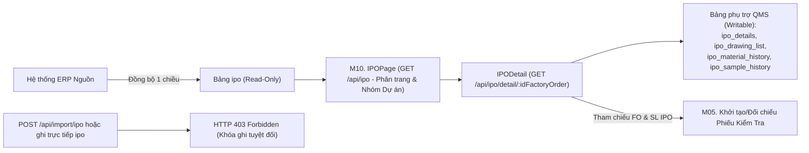

#### 4. Ma trận RBAC cấp Module & Quy tắc bảo vệ Backend
- **Xem & Xuất (`IPO:VIEW`, `EXPORT`):** `ADMIN`, `MANAGER`, `QA`, `QC_LEAD`, `QC_INSPECTOR`, `PURCHASING`.
- **Cập nhật thông tin phụ trợ (`ipo_details`, `ipo/drawings`, `ipo/materials`, `ipo/samples`):** Nhân sự được cấp quyền trên `IPO` (`ADMIN`, `MANAGER`, `QA`, `QC_LEAD`, `QC_INSPECTOR`).
- **Bảo vệ Backend (`server.ts`):** `POST /api/import/ipo` và mọi lệnh ghi lên bảng `ipo` gốc bị chặn cứng với HTTP `403`.

#### 5. Điểm tích hợp dữ liệu
- **API Endpoints:**
  - `GET /api/ipo`, `POST /api/import/ipo` *(trả `403`)*
  - `GET /api/ipo/detail/:idFactoryOrder`, `POST /api/ipo/detail`
  - `POST /api/ipo/drawings`, `POST /api/ipo/materials`
  - `POST /api/ipo/samples`, `PUT /api/ipo/samples/:id`, `DELETE /api/ipo/samples/:id`
- **Bảng PostgreSQL:** `ipo` (Read-Only), `ipo_details`, `ipo_drawing_list`, `ipo_material_history`, `ipo_sample_history`.
- **Liên kết Module:** Cung cấp `ma_nha_may`, `so_luong_ipo`, `dvt`, `ten_hang_muc` cho `M05` và đối chiếu tiến độ dự án `M02`.

---

### M11. Cài Đặt & Phân Quyền Hệ Thống (Settings & RBAC)

#### 1. Mục tiêu & Phạm vi nghiệp vụ
Là trung tâm quản trị cấu hình toàn hệ thống: quản lý tài khoản nhân sự, phân quyền RBAC chi tiết theo module/hành động, cấu trúc tổ chức (Phòng ban – Bộ phận – Tổ), danh mục xưởng/công đoạn, tùy biến mẫu checklist kiểm tra và giám sát nhật ký lỗi API.

#### 2. Chức năng chính (Nghiệp vụ & Giao diện)
`Settings.tsx` tổ chức thành 7 phân khu (Tab) linh hoạt theo quyền người dùng:
1. **`TEMPLATE` (`TemplateEditor`):** Cấu hình bộ tiêu chí kiểm tra mặc định (Checklist Templates) cho từng loại phiếu/công đoạn.
2. **`USERS` (`UserManagement`, `UserActivityList`):** Tạo/sửa/xóa tài khoản, Import nhân sự hàng loạt, cấu hình vai trò, cờ Tổ trưởng (`la_to_truong`), chữ ký mẫu (`signature_template`), module được phép và xem lịch sử hoạt động cá nhân (`/api/users/:userId/activity`).
3. **`WORKSHOPS` (`WorkshopManagement`):** Khai báo mã xưởng, địa chỉ, quản lý xưởng và danh sách công đoạn (`stages`) áp dụng tại xưởng đó.
4. **`DEPARTMENTS` (`DepartmentManagement`) & `ROLES`:** Quản trị cây cơ cấu tổ chức 3 cấp (**Phòng ban `departments` → Bộ phận `divisions` → Tổ `teams`**), đồng bộ từ dữ liệu nhân sự (`sync-departments`), và quản lý vai trò động (`qms_roles`).
5. **`SYSTEM_AUDIT` (`SystemAuditPanel`):** Tra cứu nhật ký toàn bộ lỗi HTTP `>= 400` trên hệ thống (`api_error_logs`), dọn dẹp log cũ, và chạy kiểm tra sức khỏe các module (`probe-modules`).
6. **`PROFILE`:** Người dùng tự xem thông tin hồ sơ cá nhân, chữ ký mẫu và đổi mật khẩu tài khoản của chính mình.

#### 3. Workflow & State Machine

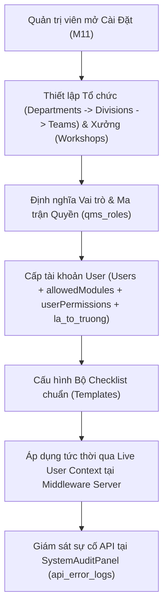

#### 4. Ma trận RBAC cấp Module & Quy tắc bảo vệ Backend
- **Nhân sự thường (`QC`, `PURCHASING`, `VENDOR`):** Mặc định chỉ thấy và thao tác trên tab `PROFILE`.
- **Quản trị viên (`ADMIN` qua `requireAdmin`):** Toàn quyền trên mọi API cấu hình (`POST /api/users/import`, `DELETE /api/users/:id`, `POST/DELETE /api/roles`, `POST/DELETE /api/workshops`, `POST /api/templates/:id`, `POST/DELETE /api/departments|divisions|teams`, `POST /api/admin/sync-departments`, `GET/DELETE /api/system/audit-errors`, `POST /api/system/probe-modules`).
- **Chống leo thang đặc quyền (Privilege Escalation Guard):** `POST /api/users` từ chối mọi yêu cầu tự gán hoặc thay đổi `role`, `allowedModules`, `userPermissions`, `la_to_truong` nếu người thực hiện không phải `ADMIN`.

#### 5. Điểm tích hợp dữ liệu
- **API Endpoints:**
  - `GET /api/users`, `GET /api/users/:id`, `POST /api/users`, `POST /api/users/import`, `DELETE /api/users/:id`, `GET /api/users/:userId/activity`
  - `GET/POST/DELETE /api/roles`
  - `GET/POST/DELETE /api/workshops`
  - `GET /api/templates`, `POST /api/templates/:id`
  - `GET/POST/DELETE /api/departments`, `/api/divisions`, `/api/teams`, `POST /api/admin/sync-departments`
  - `GET/POST/DELETE /api/system/audit-errors`, `POST /api/system/probe-modules`
- **Bảng PostgreSQL (`appQAQC`):** `users`, `qms_roles`, `workshops`, `templates`, `departments`, `divisions`, `teams`, `api_error_logs`.
- **Liên kết Module:** Cấp quyền cho `M00`–`M12`, cung cấp danh sách công đoạn (`stages`) cho `M05` & `M07`, danh sách nhân sự cho `M03` & `M09`.

---

### M12. Thùng Rác & Khôi Phục Dữ Liệu (Trash & Soft Delete)

#### 1. Mục tiêu & Phạm vi nghiệp vụ
Đảm bảo an toàn dữ liệu và tính toàn vẹn kiểm toán ISO bằng cơ chế **Xóa mềm (`deleted_at`)** thay cho xóa vật lý: cho phép cấp quản lý rà soát lại toàn bộ nội dung phiếu đã bị xóa, khôi phục về danh sách hoạt động kèm Audit Log hoặc xóa vĩnh viễn có kiểm soát nghiêm ngặt.

#### 2. Chức năng chính (Nghiệp vụ & Giao diện)
- **Danh sách Phiếu đã xóa mềm (`Trash`):** Hiển thị tất cả phiếu có `deleted_at IS NOT NULL` gồm mã phiếu, phân loại form (`IQC`, `PQC`, `SQC_*`, `FQC`...), dự án, người lập và thời gian xóa (giao diện Mobile Cards & Desktop Table).
- **Xem nhanh trước khi xử lý (`Quick Review Modal`):** Cho phép bấm xem chi tiết toàn bộ thông số số lượng, tỷ lệ đạt, ảnh hiện trường, tài liệu đính kèm và hạng mục kiểm tra của phiếu ngay trong Thùng rác.
- **Khôi phục đơn lẻ & Hàng loạt (`Restore` / `Bulk Restore`):** Đưa `deleted_at` về `NULL` và ghi nhận hành động `RESTORE_ACTION` vào bảng `audit_logs`.
- **Xóa vĩnh viễn (`Permanent Delete` / `Bulk Permanent Delete`):** Xóa bản ghi khỏi cơ sở dữ liệu sau bước xác nhận cảnh báo mức nguy hiểm cao (`danger`).

#### 3. Workflow & State Machine

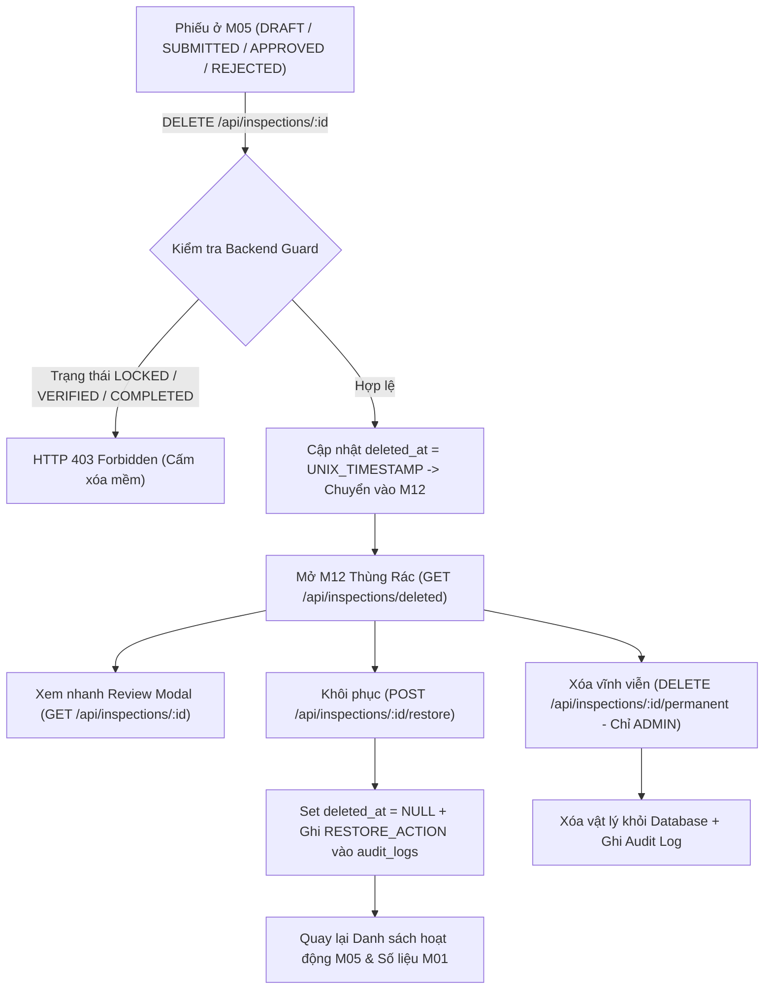

#### 4. Ma trận RBAC cấp Module & Quy tắc bảo vệ Backend
- **Xem Thùng rác & Khôi phục (`requireTrashAccess`):** Chỉ cho phép `ADMIN` hoặc tài khoản có quyền `INSPECTIONS:DELETE` hoặc `TRASH:VIEW` truy cập `/api/inspections/deleted` và `/api/inspections/:id/restore`.
- **Xóa vĩnh viễn (`requireAdmin`):** Route `DELETE /api/inspections/:id/permanent` bị khóa chặt chỉ dành riêng cho **Quản trị viên (`ADMIN`)**.

#### 5. Điểm tích hợp dữ liệu
- **API Endpoints:**
  - `GET /api/inspections/deleted` (`requireTrashAccess`)
  - `GET /api/inspections/:id` (xem Review nhanh trước khi khôi phục)
  - `POST /api/inspections/:id/restore` (`requireTrashAccess`)
  - `DELETE /api/inspections/:id/permanent` (`requireAdmin`)
- **Bảng PostgreSQL (`appQAQC`):** `inspections`, các bảng `forms_*`, `audit_logs`.
- **Liên kết Module:** Tiếp nhận phiếu bị xóa mềm từ `M05`, khôi phục đồng bộ lại `M05` và làm mới lại số liệu thống kê `M01`.
